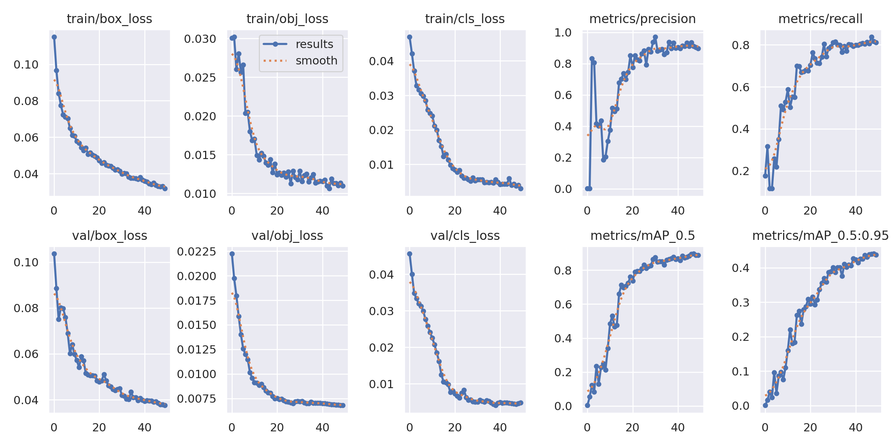

# Real-time Object Detection Driving an ESP32-S3 USB HID Device

   

A learning prototype that closes the loop between **computer vision on a PC** and **embedded USB hardware**:
a custom-trained YOLOv5 model detects targets in a live screen region, the PC computes the offset from the
centre of the frame, and an **ESP32-S3 acting as a native USB mouse (TinyUSB HID)** moves the cursor.
Built and tested using *Counter-Strike 2* footage as the detection scenario.

```
 Screen capture (mss) ──► YOLOv5s (custom weights) ──► target centre ─► Δx, Δy
                                                                            │  4-byte packet over UART
                                                                            ▼
                                       PC ◄── USB HID mouse reports ── ESP32-S3 (TinyUSB)
```

## Components

| Path | What it does |
|---|---|
| [`pc/detect_and_send.py`](pc/detect_and_send.py) | Captures a screen region with `mss`, runs YOLOv5 via `torch.hub`, draws boxes per class, computes the target offset while the right mouse button is held, encodes it as `[signX, |Δx|, signY, |Δy|]`, and records an annotated `.avi` for review. |
| [`firmware/esp32s3-hid-mouse/`](firmware/esp32s3-hid-mouse) | ESP-IDF firmware. Registers as a **USB HID keyboard + mouse** with TinyUSB, receives 4-byte packets on UART1 (GPIO17/18, 115200 baud) in a FreeRTOS task, and turns them into `tud_hid_mouse_report()` calls. |
| [`firmware/esp32s3-usb-host-mouse/`](firmware/esp32s3-usb-host-mouse) | Earlier experiment: ESP32-S3 as **USB host** reading a real mouse (HID boot protocol) and redirecting the console to a UART — the first step towards a mouse pass-through. Based on Espressif's `usb/host/hid` example. |
| [`training/results/`](training/results) | Training run outputs: loss/metric curves, PR curve, confusion matrix, sample validation predictions, hyper-parameters. |

## Model
- Base: **YOLOv5s** (`yolov5s.pt`), fine-tuned for 50 epochs, 640 px, batch 16
- Dataset: [cs2-AI (Roboflow Universe)](https://universe.roboflow.com/counterstrike-2/cs2-ai-9m0vx) — 344 images, 4 classes (CT body / CT head / T body / T head), public domain
- Validation after 50 epochs: **precision 0.90 · recall 0.81 · mAP@0.5 0.89 · mAP@0.5:0.95 0.44**



## Running it
1. Clone [ultralytics/yolov5](https://github.com/ultralytics/yolov5) and install its requirements (YOLOv5 code is **not** included here — AGPL-3.0).
2. Train: `python train.py --img 640 --batch 16 --epochs 50 --data data.yaml --weights yolov5s.pt`
3. Edit the `torch.hub.load(...)` path in `pc/detect_and_send.py` to point at your YOLOv5 folder and `best.pt`.
4. Flash `firmware/esp32s3-hid-mouse` (`idf.py set-target esp32s3 && idf.py flash`), connect a USB-UART adapter to GPIO17/18 and the S3's native USB port to the PC.
5. Uncomment the `serial.Serial(...)` / `ser.write(...)` lines and set your COM port.

## Status / known issues
This is a **prototype** I used to learn the full pipeline, not a finished tool:
- Serial output is commented out in the Python script (it was run in "log and record" mode for tuning).
- Firmware uses `data[2]` for the Y magnitude; the protocol sends it in `data[3]`.
- Offsets are sent as single bytes (±255) with no scaling or smoothing.
- Capture region and crop are hard-coded for a 1920×1080 screen.

## What I learned
Custom dataset fine-tuning and evaluation with YOLOv5 · real-time screen capture and inference latency ·
designing a minimal binary serial protocol · TinyUSB HID descriptors on the ESP32-S3 · USB host vs device
roles · FreeRTOS tasks and UART drivers in ESP-IDF.

## Credits
- [Ultralytics YOLOv5](https://github.com/ultralytics/yolov5) (AGPL-3.0)
- Dataset: [cs2-AI on Roboflow Universe](https://universe.roboflow.com/counterstrike-2/cs2-ai-9m0vx)
- Firmware started from Espressif ESP-IDF examples (`tinyusb/hid`, `uart_async_rxtxtasks`, `usb/host/hid`)
- Inspired by [RootKit-Org/AI-Aimbot](https://github.com/RootKit-Org/AI-Aimbot)

*For educational purposes only. Using input automation in online games violates their terms of service.*
